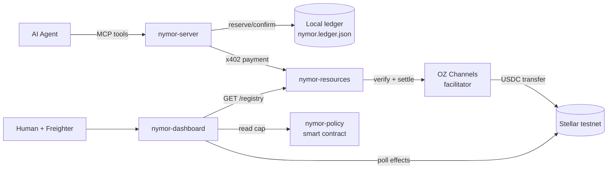

## Packages

| Package | Role |
|---|---|
| `packages/resources` (`@nymor/resources`) | Seller side. Two real paid endpoints — `GET /xlm-price` (live CoinGecko data) and `POST /summarize` (real LLM call via OpenRouter) — gated by x402. Also serves `GET /registry`, a read-only mirror of the resource catalog for the dashboard. |
| `packages/server` (`@nymor/server`) | The product. An MCP server exposing `nymor.discover`, `nymor.pay_and_call`, `nymor.spend_status`, `nymor.register_resource`, backed by a file-persisted registry and ledger. |
| `packages/policy` (`nymor-account`, `nymor-spending-limit-policy`) | Soroban smart-account contracts, deployed live on testnet, that enforce a spend cap at the network level. See [On-chain policy](/on-chain-policy). |
| `packages/dashboard` (`@nymor/dashboard`) | A public web app: browse the registry, watch real payments land in a live feed, pay for a resource yourself with Freighter, and read the live on-chain cap. See [Dashboard](/dashboard). |

## The payment mechanism

x402 is a challenge-response protocol built on the HTTP 402 status code:

<Steps>
  <Step title="Request without payment">
    The agent (via `nymor-server`) requests a resource with no payment attached.
  </Step>
  <Step title="402 Payment Required">
    `nymor-resources` returns `402`, with the payment requirements (price, network, destination address) encoded in a `PAYMENT-REQUIRED` response header — not the JSON body. This is an x402/express convention, confirmed by inspecting a real response rather than assumed from docs, and it mattered: it's the exact detail that broke the dashboard's browser-based payment flow until CORS was fixed to expose that header.
  </Step>
  <Step title="Sign and pay">
    The buyer signs a Stellar transaction invoking `transfer` on the USDC Stellar Asset Contract (SAC) — this is a Soroban `invoke_host_function` operation, not a classic Payment operation, which matters for anything reading payment history off-chain (see the [dashboard's live-activity panel](/dashboard)). The signed payment is submitted to the OZ Channels facilitator for verification and settlement.
  </Step>
  <Step title="Retry with proof">
    The original request is retried with an `X-PAYMENT` header carrying the payment payload. The resource responds with real data, and a `X-PAYMENT-RESPONSE` header carrying the settled Stellar transaction hash.
  </Step>
</Steps>

## The spend-gate: two layers, not one

Before any payment happens, `nymor-server` checks a budget. There are two enforcement layers, and — this is the detail worth being precise about — **they are not currently connected to each other**:

1. **Local ledger (`nymor.ledger.json`)** — an atomic reserve/confirm/release pattern under a file lock (`reserveSpend` → `confirmReservation` or `releaseReservation`), proven race-safe with a 20-way concurrency test. This is what actually gates every real payment `nymor-server` makes today.
2. **On-chain policy (`nymor-account` + `nymor-spending-limit-policy`)** — a Soroban smart account that refuses to authorize a transfer past its cap, enforced by the Stellar network itself, not application code. Deployed and proven on testnet with real transactions — but **not yet wired into the buyer's live signing path**. Full detail, including why, in [On-chain policy](/on-chain-policy).

The local ledger stays useful regardless — it's what powers `nymor.spend_status` and human-readable "why was this blocked" explanations. The on-chain layer is the enforcement that can't be bypassed by a bug in `nymor-server`'s own code; the local layer is the one that's actually live.

## Buyer signing today

`payment.ts` signs with a raw Ed25519 keypair (`createEd25519Signer` from `@x402/stellar`), not through the smart account. This is a deliberate, disclosed gap — see [On-chain policy](/on-chain-policy#why-the-buyer-still-signs-with-a-raw-key) for the specific library limitation that caused it.
