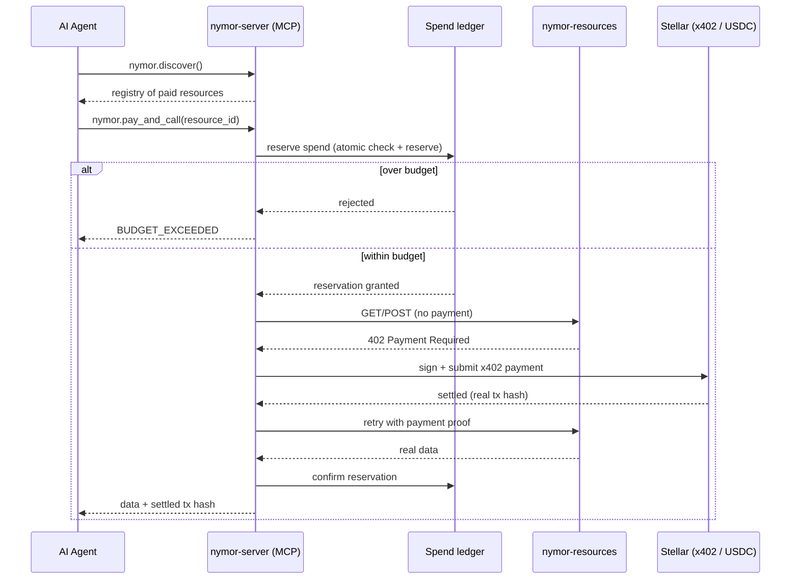

Nymor lets any MCP-connected AI agent do three things without a human in the loop: **discover** paid API resources, **pay** for them autonomously in USDC settled on Stellar via the [x402 protocol](https://developers.stellar.org/docs/build/agentic-payments/x402), and **stay inside a spend cap** — enforced two ways, one of them by the Stellar network itself.

<Note>
  This documentation follows one rule throughout: every claim is tagged as either verified with a real passing test or a real on-chain transaction, or explicitly flagged as not yet wired up. See [Where things stand](/status) for the full accounting — nothing here is rounded up.
</Note>

## The problem

Today, an AI agent that wants to call a paid API needs a human to hold the wallet: someone has to provision an API key, load a prepaid balance, or approve each charge. That breaks the moment you want an agent to autonomously shop across dozens of paid resources it has never seen before, or to run unattended for hours. Nymor removes the human from that loop, without removing the safety rail — the agent can discover and pay for resources on its own, but it can never spend past a cap you set.

## Core components

Nymor is three cooperating pieces plus a dashboard for humans:

<CardGroup cols={2}>
  <Card title="Discovery" icon="magnifying-glass" href="/architecture">
    `nymor.discover` reads a file-persisted registry of paid resources — real ones, not placeholders: a live XLM/USD price feed and a real LLM-backed summarizer.
  </Card>
  <Card title="Spend-gate" icon="shield-check" href="/on-chain-policy">
    Every payment is checked against a budget before it happens. That check exists at two layers — an application-level ledger, and (new) a Soroban smart-account contract that the network itself enforces.
  </Card>
  <Card title="Payment" icon="coins" href="/architecture">
    Real x402: a genuine HTTP 402 challenge, a real signed Stellar transaction, real USDC settlement — verified against independently-checkable transaction hashes throughout, not mocked.
  </Card>
  <Card title="Dashboard" icon="chart-line" href="/dashboard">
    A public web app for humans: browse the registry, watch real payments land in a live feed, pay for a resource yourself with a Freighter wallet — no agent required.
  </Card>
</CardGroup>

## Request flow

An agent talks to Nymor over MCP in two calls: `discover()` to see what's for sale, then `pay_and_call(resource_id)` to spend and fetch. Everything between those two calls — the budget check, the 402 challenge, the signed Stellar payment, the retry with proof — happens automatically, and every step either succeeds with a real, checkable result or fails with a typed error.

The diagram below traces that second call in full:

## Design principles

Most "AI agent payments" demos either fake the money movement or fake the safety rail. Nymor's build rule from day one was: no `Math.random()` standing in for real data, no skipped payment verification, no in-memory-only state, every failure path returns a typed error. That rule is why the project is smaller and slower to build than a mocked equivalent — and why every claim in these docs points at something you can check yourself: a passing test, or a transaction hash on [Stellar Expert](https://stellar.expert/explorer/testnet).

## Next steps

<CardGroup cols={3}>
  <Card title="Quickstart" icon="rocket" href="/quickstart">
    Run the seller, the MCP server, and the dashboard locally.
  </Card>
  <Card title="Architecture" icon="sitemap" href="/architecture">
    How the packages fit together, and the exact payment mechanism.
  </Card>
  <Card title="Honest status" icon="clipboard-check" href="/status">
    What's live-and-verified, what's built-but-not-wired, what's roadmap.
  </Card>
</CardGroup>
