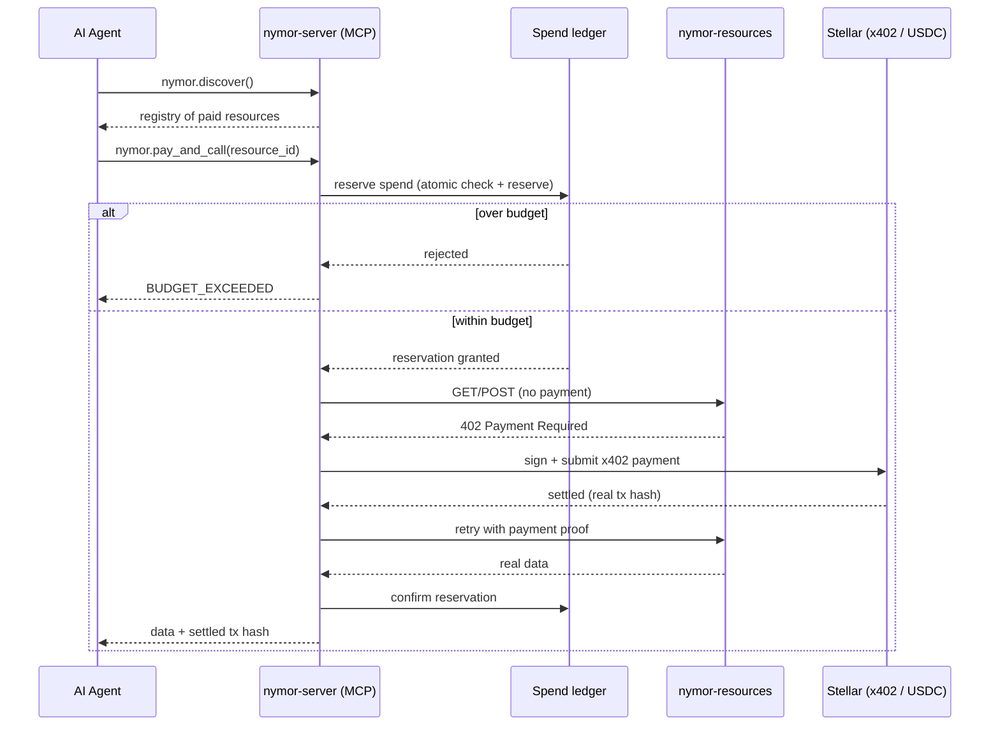

<Note>
  This page is written to stand alone — as a technical blog post as much as a documentation page. Every specific claim below links to something you can check yourself: a transaction on Stellar Expert, or a test in the repository.
</Note>

## The problem with "the agent has a budget"

Most descriptions of AI-agent payment systems include a line like "the agent stays within a spend limit." It's an easy sentence to write and a much harder one to make true in a way that survives contact with a bug, or a prompt injection, or a dependency that silently changes behavior. If the thing enforcing the budget is application code the agent's own execution path can influence, "the agent has a budget" is really just "the agent has been asked nicely to have a budget."

Nymor is an MCP server that lets any MCP-connected AI agent discover paid API resources and pay for them autonomously in USDC settled on Stellar, via the [x402 protocol](https://developers.stellar.org/docs/build/agentic-payments/x402). It started, like most projects in this space, with the budget enforced by application code: a file-persisted ledger, atomic reserve-and-confirm semantics, a 20-way concurrency test proving no double-spend under race conditions. That's real engineering and it's genuinely race-safe — but it's still enforcement an agent's own compromised or buggy execution path could, in principle, route around, because it lives in the same trust boundary as the agent's own tool calls.

The interesting technical work — and the reason this is worth writing up rather than just shipping — was moving that enforcement one layer down, to somewhere a compromised agent can't reach it at all: the Stellar network's own transaction-authorization path.

## Discovery, spend-gate, payment: the mechanism

An agent calls `nymor.discover` and gets back a registry of real paid resources — a live XLM/USD price feed, a real LLM-backed summarizer, both gated by x402. It calls `nymor.pay_and_call`, the local ledger reserves the spend atomically, `nymor-server` signs and submits a real Stellar transaction, the resource verifies settlement and returns real data, and the reservation confirms. Every step of that loop moves real money or returns a typed error — there's no offline/mocked mode, by design, because a mocked payment flow doesn't tell you anything about whether the real one works.

## Moving the budget onto the chain

The spec for this project's on-chain policy work asked for something specific and checkable: a Soroban smart-account contract that refuses to authorize a transfer past a cap, and two real transactions proving it — one accepted, one rejected — not test output presented as equivalent to a live result.

[OpenZeppelin's `stellar-accounts`](https://github.com/OpenZeppelin/stellar-contracts) library made the core building block straightforward: an audited, reference `spending_limit` policy that panics with `SpendingLimitExceeded` when a transfer would exceed a rolling-window cap. `nymor-account` and `nymor-spending-limit-policy` are thin wrappers around that library — deployed live on Stellar testnet, with a buyer's real signing key and a 1.00 USDC/day cap, and the deployed state read back directly from chain (`get_context_rule`, `get_spending_limit_data`) rather than just trusting that the deploy transaction succeeded.

The genuinely hard part was getting a *real signed transaction* through that contract's authorization path — not a local test, an actual transaction the Stellar network either accepts or rejects.

### Why a standard signer can't do this

OZ smart accounts don't authenticate with a plain signature over the transaction hash. They bind the *selected authorization rule* into what gets signed: `auth_digest = sha256(signature_payload || context_rule_ids.to_xdr())`, specifically to prevent an attacker from collecting a signature under a strict rule and then swapping in a weaker one before submission. The signature then has to be wrapped in an `AuthPayload{context_rule_ids, signers}` structure, not the classic `{public_key, signature}` shape most Stellar tooling assumes.

`stellar-sdk`'s own `authorizeEntry()` helper — and by extension `@x402/stellar`, which calls it internally with no override hook — only knows how to build that classic shape. There's no way to make a normal x402 payment flow authorize through this kind of smart account without forking `@x402/stellar`'s internals, which is a materially different scope than implementing a custom signer (something its `ClientStellarSigner` interface genuinely does support, just not for this). That's a disclosed, deliberate gap in this project: production agent payments still sign with a raw Ed25519 key, not the smart account. [The full explanation is documented](/on-chain-policy#why-the-buyer-still-signs-with-a-raw-key), because a safety feature that's built but not load-bearing is worth being precise about, not rounding up.

### The undocumented second entry

Proving the *contract's own logic* was correct, though, didn't require solving that library problem — it required building one standalone script that could construct a valid authorized transaction by hand. That turned up something genuinely undocumented.

OZ's smart-account signer type used here, `Signer::Delegated(Address)`, authenticates via `buyer.require_auth_for_args((auth_digest,))` — called from *inside* the smart account's own `__check_auth`. The natural assumption is that this call gets satisfied by the same top-level authorization entry as everything else. It doesn't. Reading `soroban-env-host`'s `auth.rs` directly showed that `require_auth_for_args` reuses the exact same matching mechanism as a normal `require_auth()` call, matched against whatever contract is on top of the call stack at that moment — which, inside `__check_auth`, is the smart account itself, invoking a function literally named `__check_auth`. The Soroban host therefore requires a *second*, entirely separate `SorobanAuthorizationEntry` for the buyer's classic account, whose invocation tree is `ContractFn(contract=nymor-account, function="__check_auth", args=[auth_digest])` — signed with the buyer's ordinary Ed25519 key, using the standard account-authentication format, nested one level inside the custom-scheme entry that's authorizing the actual transfer.

OpenZeppelin's own package documentation confirms this can't be discovered by simulation: *"this model requires manual authorization entry crafting, because it is not returned in a simulation mode."* No reference implementation for constructing that entry exists anywhere in their repository or examples — the multisig reference example in the same codebase uses `External` verifier-contract signers instead, sidestepping the problem entirely. The shape used here came from reading the host's source, not from a guide.

With both pieces in place — the custom digest for the top-level entry, the second standard entry for the delegated signer — a standalone script (`packages/server/scripts/onchain-proof.mjs`) submitted two real transactions:

<CardGroup cols={2}>
  <Card title="Under cap — accepted" icon="circle-check" color="#4ade80" href="https://stellar.expert/explorer/testnet/tx/e4358552e77b46c87a5ff408bd42cd63efbf26a276e41806148b364a6bd1c4b2">
    0.10 USDC, `successful: true`
  </Card>
  <Card title="Over cap — rejected on-chain" icon="circle-xmark" color="#f87171" href="https://stellar.expert/explorer/testnet/tx/d0f3e128df2bd2d2582a532c32e119dedd1957afdaa79f50412eebca76965f74">
    0.90 USDC, `successful: false`, `Error(Contract, #3221)`
  </Card>
</CardGroup>

Both cross-checked against the policy contract's own state read: the rejected transaction left `cached_total_spent` unchanged, confirming clean rollback rather than a partial write.

## Where the CORS bugs came from

The dashboard's "try it yourself" panel — a human paying with their own [Freighter](https://www.freighter.app/) wallet, no agent involved — surfaced a different category of problem: the payment code was correct, but nothing about `nymor-resources` had ever been called from a browser before, only from Node and curl. Three separate CORS issues stacked on top of each other, each one masking the next until the previous was fixed: missing CORS headers entirely, a `PAYMENT-REQUIRED` response header (where `@x402/express` actually puts the 402 payload, not the JSON body) that wasn't exposed to the browser, and — the one actually worth flagging as a finding rather than a mistake — a real bug in `@x402/fetch` v2.23.0, which sets `Access-Control-Expose-Headers`, a response-only header, as a *request* header on the signed retry. Browsers reject unlisted headers during CORS preflight, so the real payment header never made it out until that name was explicitly allowlisted server-side. [Full writeup here](/dashboard#try-it-yourself-three-real-cors-bugs-in-order).

## An honest read of the landscape

This space is genuinely early. [MPPScan](https://www.mppscan.com/), a public activity tracker for one major protocol variant, reported roughly 31,100 transactions and $3,730 in total volume across ~671 agents as of late March 2026 — for the *entire tracked ecosystem*, not one product. No market-sizing exercise changes that; the honest framing is a small number of early builders testing whether this gets used before it's assumed to scale. Nymor's own footprint is smaller still: testnet-only, a handful of real settled transactions, no production users beyond people clicking through the dashboard.

Set against the closest comparable project, [Nirium](https://www.nirium.xyz/) — live on Stellar mainnet since July 2026, with real audit and institutional-reporting infrastructure this project doesn't attempt — the honest comparison is narrow, not a claim of overall superiority. Nirium's own site describes a planned "Compliance Sentinel" policy-enforcement feature and marks it explicitly as roadmap: *"should not be relied upon currently."* That's the specific feature this project's on-chain work delivers, with a real accepted transaction and a real network-rejected one as proof. Nirium is ahead on maturity and production deployment. Nymor is ahead on one narrow, checkable claim that a more mature, mainnet-live competitor's own roadmap says isn't built yet, anywhere. [Full comparison, including the x402 Bazaar and MPPScan, is here](/landscape).

## What's proven, what isn't

The discipline applied throughout this project — and the reason this write-up leans on transaction hashes rather than adjectives — is refusing to round up. The on-chain policy contract is deployed, its enforcement logic is proven by both a real rejected transaction and a passing test, and it is *not* currently what stops a real agent payment from overspending — the local ledger still is, because wiring the two together hits a real, disclosed library limitation rather than an oversight. [The complete, tag-by-tag status is here](/status): verified, built-but-untested, or not started, for every piece of the project, including the small stuff.

That's the actual point of writing this up. A safety claim is worth exactly as much as the thing a reader can go check for themselves — and in this case, that's two transaction hashes, a passing test suite, and a paragraph explaining precisely where the boundary of "actually enforced" currently sits.
